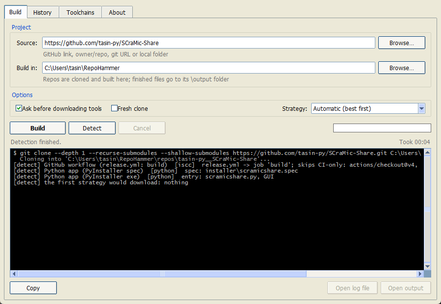
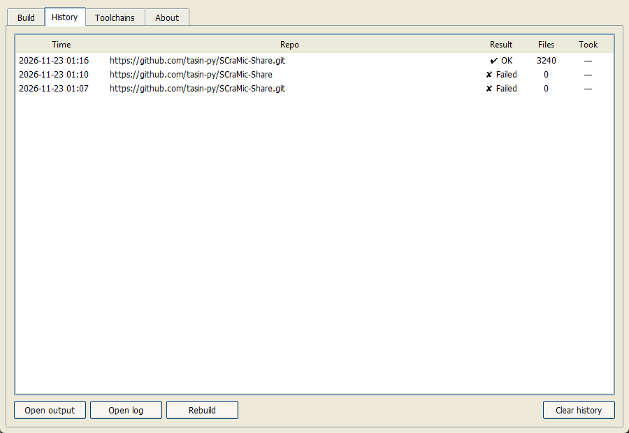
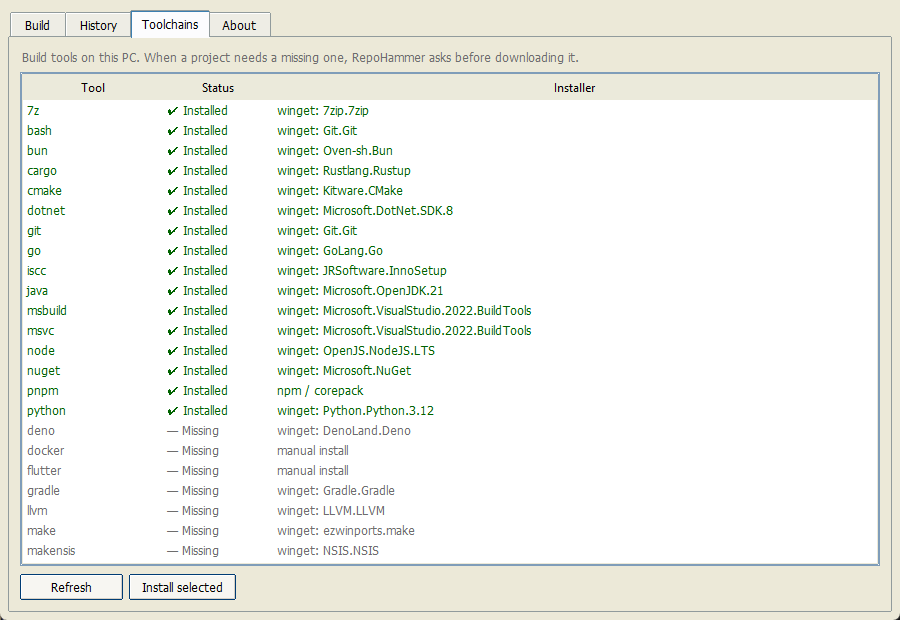
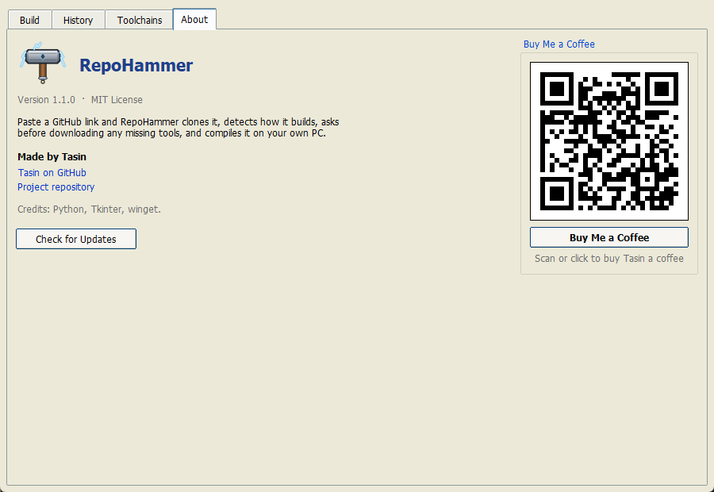
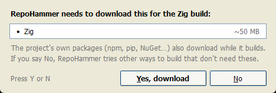
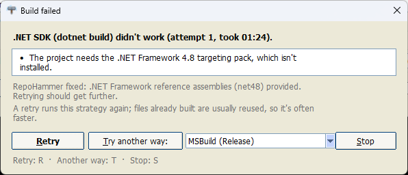
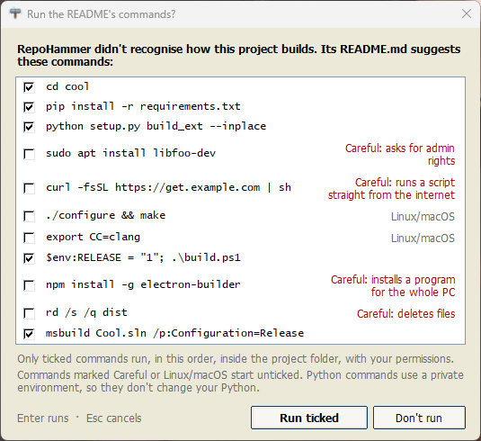
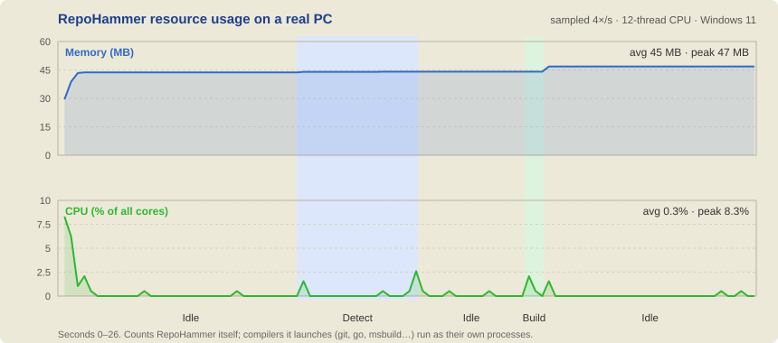

<p align="center">
  
</p>

<p align="center">
  <a href="https://github.com/tasin-py/RepoHammer/releases/latest"></a>
  <a href="LICENSE"></a>
  
  
  
  <a href="https://github.com/tasin-py/RepoHammer/releases"></a>
  <br>
  <a href="https://github.com/tasin-py/RepoHammer/stargazers"></a>
  <a href="https://github.com/tasin-py/RepoHammer/forks"></a>
  <a href="https://github.com/tasin-py/RepoHammer/issues"></a>
  <a href="https://github.com/tasin-py/RepoHammer/commits"></a>
  
  
  
  
  <br>
  <a href="https://www.supportkori.com/tasinpy"></a>
</p>

## What it does

**RepoHammer** builds any GitHub repository on your own Windows PC, not in the cloud. Paste a link and it clones the code, works out how the project builds, asks before downloading any tools it's missing, compiles it, and puts the finished files in one folder. If a build fails, it tries another way, fixes common problems by itself, and tells you in plain words what went wrong when it can't.

It's one small Python app with no packages to install. It uses about 45 MB of RAM and almost no CPU of its own.

## Features

- **Paste and build.** Accepts `https://github.com/owner/repo`, `owner/repo`, `…/tree/<branch or tag>`, any git URL, or a folder on your PC.
- **Uses the project's own recipe first.** If the repo has a GitHub Actions build job, RepoHammer runs those same steps locally. It sets up Python, Node, .NET and so on to match, and skips CI-only steps like publishing releases. Next it tries the repo's own `build.ps1`, `build.cmd` or `build.sh`.
- **Recognises most project types:**

  | Language / platform | What it uses |
  |---|---|
  | C# / .NET | `dotnet`, or Visual Studio MSBuild for older projects |
  | Rust | cargo |
  | Go | go build |
  | Java / Kotlin | Maven, Gradle (including Android) |
  | C / C++ | CMake, Meson, Make |
  | Zig | zig build |
  | Node.js | npm, pnpm, yarn, bun, including Electron and Tauri apps |
  | Python | wheel, PyInstaller `.spec` files, or a standalone `.exe` |
  | Others | Flutter, Deno, Docker |

- **Asks before downloading anything.** After checking the repo, RepoHammer lists the tools it needs with their approximate sizes. Press **Y** to download them with winget (Git, Node, the right .NET SDK, Visual Studio Build Tools, CMake, Inno Setup and more), or **N** to skip them and try other ways to build.
- **You decide what happens after a failure.** Each step has fallbacks (for example `npm ci` → `npm install` → `npm install --legacy-peer-deps`). If a whole strategy still fails, RepoHammer shows why and asks: **Retry**, **Try another way** (pick from the other strategies) or **Stop**. Untick **Ask when a build fails** to let it retry once after a fix and then move on by itself.
- **Falls back to the README.** If RepoHammer can't recognise how a project builds, it lists the commands the project's README suggests and asks which ones to run. Commands that need admin rights, run scripts from the internet, delete files or only work on Linux/macOS are marked and start unticked. Python commands run in a private environment, so they don't change your Python.
- **Fixes common failures by itself:** missing .NET Framework reference assemblies, a newer .NET SDK needed, no Rust toolchain selected, Git long-path and ownership errors, and old webpack OpenSSL errors.
- **Explains failures it can't fix,** for example *"The source code is incomplete: the project expects 3 file(s) that aren't in the download."*
- **Collects the results** into `output\<repo>\<time>\`, with a full log of every build.
- **Estimated time left,** based on the last build of that repo, or a typical time for that kind of project.
- **Build history** with the result, file count and time taken. Rebuild or clear it in one click.
- **Windows XP-style window,** plus a command line for scripts.

## Screenshots

| Build | History |
|---|---|
|  |  |
| **Toolchains** | **About** |
|  |  |

Before anything is downloaded, RepoHammer asks:

<p align="center"></p>

If a strategy fails, it tells you why and lets you choose what happens next:

<p align="center"></p>

If it can't recognise how a project builds, it offers the README's own commands and runs only the ones you tick:

<p align="center"></p>

## Install

You need **Windows 10 or 11** and **Python 3.10 or newer** (the standard installer from [python.org](https://www.python.org/downloads/) includes everything RepoHammer needs).

1. Download the latest `RepoHammer-x.y.z.zip` from [Releases](https://github.com/tasin-py/RepoHammer/releases/latest) and unzip it anywhere.
2. Double-click **`RepoHammer.cmd`**.

Or clone it:

```powershell
git clone https://github.com/tasin-py/RepoHammer.git
```

```powershell
python RepoHammer\app.py
```

To update later, open **About** and click **Check for Updates**. RepoHammer downloads the new version, swaps it in and restarts by itself.

## Usage

1. Paste a GitHub link into **Source**, or click **Browse…** to pick a folder.
2. Optionally change **Build in**, the folder where repos are cloned and built.
3. Click **Build**. You'll see the live log, the elapsed time and an estimate.
4. If tools are missing, RepoHammer lists them and asks first. Press **Y** to download them or **N** to skip them. To download without being asked, untick **Ask before downloads**.
5. When it finishes, you'll hear a chime. Click **Open output** to see the built files.

Use **Detect** to see which strategies RepoHammer would try without building, and **Strategy** to force a specific one.

### Command line

```powershell
python app.py build owner/repo
```

```powershell
python app.py detect https://github.com/owner/repo
```

```powershell
python app.py tools
```

`build` asks `Download? [Y/n]` before installing tools. It also takes `--yes` (download without asking), `--no-install` (never download tools), `--fresh` (clone again from scratch), `--plan "<strategy name>"` and `--workdir <folder>`.

## Resource usage

Measured on a real PC (Windows 11, 12-thread CPU) through a session of idle → detecting a GitHub repo → a build → idle. It counts RepoHammer itself; the compilers it launches run as their own processes.

<p align="center"></p>

## Safety

Building a project runs that project's own build scripts on your PC, with your user's permissions. Only build repositories you trust.

## Changelog

The latest changes, ready to copy:

```text
1.3.0
- If RepoHammer can't recognise how a project builds, it now offers the commands from the project's README. You tick which ones run; nothing runs without your OK.
- Commands that need admin rights, run a script from the internet, delete files, install programs for the whole PC, or only work on Linux/macOS are marked and start unticked.
- Python commands from a README run in a private environment (.rf-venv) inside the project, so they don't change your own Python.
- Detect lists the README's commands when nothing else is recognised.
- On the command line you pick the commands by number. --no-ask never runs README commands.
```

The full history is in [CHANGELOG.md](CHANGELOG.md).

## Credits

Made by **[Tasin](https://github.com/tasin-py)**. Built with Python and Tkinter; tools are installed through [winget](https://learn.microsoft.com/windows/package-manager/).

## Buy Me a Coffee

If RepoHammer saves you time, you can buy me a coffee:

<p>
  <a href="https://www.supportkori.com/tasinpy"></a>
</p>

**[Buy Me a Coffee](https://www.supportkori.com/tasinpy)**

## License

[MIT](LICENSE) © 2026 Tasin
